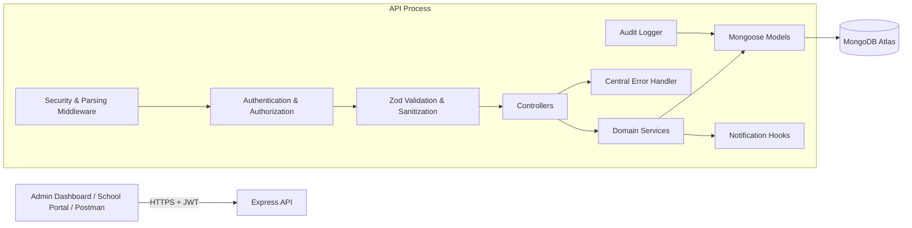
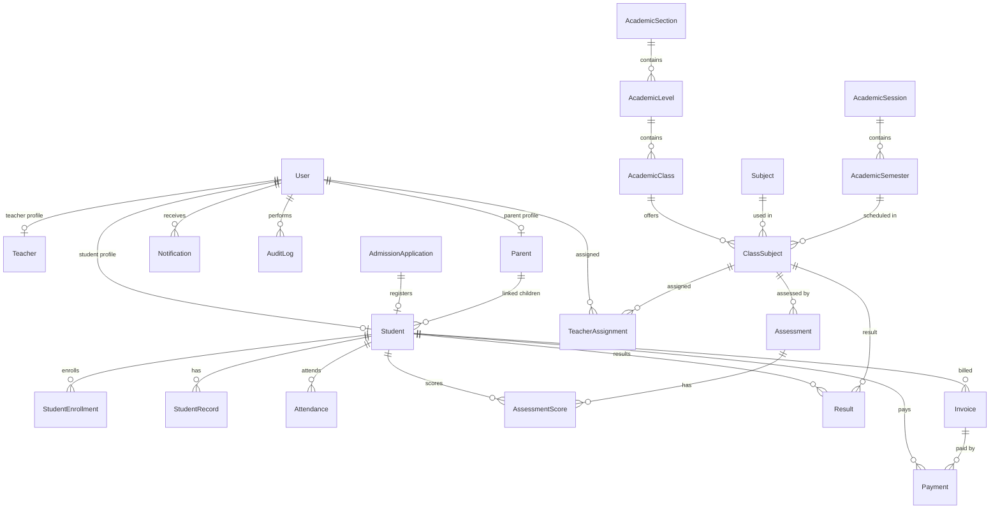

# Darul Ulum Management System — System Architecture

> Backend: Node.js + Express 5 + MongoDB/Mongoose
> API version: v2
> Branch: `v2-clean-architecture`

---

## 1. High-Level Architecture



The backend follows a layered clean-architecture style:

- **Routes** define HTTP paths, middleware, and authorization.
- **Middleware** handles security, request parsing, validation, auth, and errors.
- **Controllers** translate HTTP requests to service calls and format responses.
- **Services** contain business rules and orchestration.
- **Models** define persistence, validation, indexes, and relationships.
- **Utilities** contain reusable date, pagination, grading, search, sequence, and
  error helpers.

The frontend is not a security boundary. Every rule is enforced by the API.

---

## 2. Directory Structure

```text
backend/
├── src/
│   ├── app.js                  Express app, middleware, route mounting
│   ├── server.js               Startup, DB connection, seeding, shutdown
│   ├── config/
│   │   ├── db.js               MongoDB connection
│   │   └── env.js              Environment validation
│   ├── controllers/            HTTP request/response adapters
│   ├── middleware/
│   │   ├── authMiddleware.js   JWT verification, role checks, password gate
│   │   ├── auditLogger.js      Non-blocking mutation audit logging
│   │   ├── errorMiddleware.js  Central error normalization
│   │   ├── rateLimiters.js     Global and auth rate limits
│   │   ├── requestSanitizer.js MongoDB operator stripping
│   │   └── validate.js         Zod validation middleware
│   ├── models/                 Mongoose schemas and indexes
│   ├── routes/                 Express routers and access policy
│   ├── seeds/
│   │   └── adminSeeder.js      Initial admin account
│   ├── services/               Domain/business logic
│   ├── utils/
│   │   ├── AppError.js         Typed application errors
│   │   ├── date.js             UTC date helpers
│   │   ├── grading.js          Weighted scores and grade scale
│   │   ├── pagination.js       Page/limit helpers
│   │   ├── search.js           Safe regex search helpers
│   │   └── sequence.js         Atomic invoice/receipt counters
│   └── validators/             Zod request schemas by module
├── .env.example
├── package.json
└── package-lock.json
```

---

## 3. Request Lifecycle

1. **CORS and Helmet** apply security headers and origin checks.
2. **Body parsers** accept JSON and URL-encoded data up to 1 MB.
3. **Request sanitizer** strips MongoDB operators from body, query, and params.
4. **Rate limiter** rejects excessive traffic with `429`.
5. **Audit logger** registers a response-finish listener for authenticated
   mutations. It does not block the request.
6. **Route middleware** applies JWT verification and role authorization.
7. **Password gate** blocks all protected routes except profile and
   change-password while `mustChangePassword` is true.
8. **Zod validation** validates body, query, or params. Validated query values
   are stored in `req.validatedQuery` because Express 5 query objects are
   read-only.
9. **Controller** calls one or more services.
10. **Service** enforces business rules, reads/writes models, and may create
    notifications.
11. **Controller** returns the standard response envelope.
12. **Error middleware** normalizes Mongoose, JWT, Zod, and application errors.
13. **Audit logger** writes the mutation record after the response finishes.

### Error mapping

| Source | Typical status |
| --- | --- |
| Zod validation | `400` |
| Invalid JWT | `401` |
| Missing/invalid role | `403` |
| Missing resource | `404` |
| Duplicate unique key | `409` |
| Business rule violation | `400` or `422` |
| Unknown server error | `500` |

Errors use `AppError` and helpers: `badRequest`, `unauthorized`, `forbidden`,
`notFound`, `conflict`, and `unprocessable`.

---

## 4. Authentication and Authorization

### Authentication

- Login accepts username or email.
- Passwords are hashed with bcrypt.
- JWT contains `id` and `role`, signed with `JWT_SECRET`.
- `protect` loads the current user and rejects inactive accounts.
- `mustChangePassword` is enforced globally after authentication.

### Roles

| Role | Scope |
| --- | --- |
| `admin` | Full system administration |
| `teacher` | Assigned classes/subjects, attendance, assessments, published results |
| `student` | Own academic, attendance, and finance data |
| `parent` | Linked children's academic, attendance, and finance data |

### Access-control helpers

`services/accessControlService.js` centralizes:

- Student access checks for admin/teacher/student/parent.
- Parent-to-student link checks.
- Teacher class access (class teacher or active subject assignment).
- Teacher class-subject assignment checks.
- Resolution of Teacher, Student, and Parent profiles from User records.

---

## 5. Data Model Overview

### Identity and academic structure

| Model | Purpose |
| --- | --- |
| `User` | Login identity and role, linked to profile |
| `AcademicSection` | Top-level section (e.g. Junior Secondary) |
| `AcademicLevel` | Level within a section |
| `AcademicClass` | Class arm within a level |
| `AcademicSession` | Academic year |
| `AcademicSemester` | Semester within a session |
| `Subject` | Subject definition |
| `ClassSubject` | Subject offered by a class in a semester |
| `TeacherAssignment` | Teacher user assigned to a class subject |

### Admissions and students

| Model | Purpose |
| --- | --- |
| `AdmissionApplication` | Applicant, guardian, approval, payment status |
| `Student` | Registered student profile |
| `StudentEnrollment` | Student-class-session membership |
| `StudentRecord` | Promotion, transfer, withdrawal, and other records |
| `Parent` | Parent profile linked to user and students |

### Teaching and learning

| Model | Purpose |
| --- | --- |
| `Attendance` | Daily student attendance per class |
| `TeacherAttendance` | Daily teacher attendance |
| `Assessment` | Assessment definition and weight |
| `AssessmentScore` | Student score for an assessment (manual or CBT-sourced) |
| `Result` | Computed weighted result per class subject and semester |
| `CbtQuestion` | Reusable question bank entry for a subject |
| `CbtExam` | Timed CBT exam for a class subject |
| `CbtExamQuestion` | Exam-specific question snapshot, order, and marks |
| `CbtAttempt` | Student attempt with timer, shuffled order, and result |
| `CbtAttemptAnswer` | Saved answer per question with grading outcome |

### Finance

| Model | Purpose |
| --- | --- |
| `FeeStructure` | Fee amount by class/session/semester |
| `Invoice` | Student invoice with items and derived status |
| `Payment` | Payment against an invoice |
| `Counter` | Atomic sequence numbers for invoices/receipts |

### Communication and administration

| Model | Purpose |
| --- | --- |
| `Announcement` | Role/class-targeted announcement |
| `AnnouncementRead` | Per-user read receipt |
| `Message` | Direct user-to-user message |
| `Notification` | Per-user in-app notification |
| `AuditLog` | Authenticated mutation audit trail |
| `SystemSetting` | Key/value system configuration |

### Key relationships



---

## 6. Module Design

### Academic setup

Academic setup is admin-only. Sessions and semesters provide the time context
for class subjects, attendance, assessments, results, invoices, and reports.
Classes are linked to levels; levels are linked to sections.

Course codes are shared across class arms in a level and are indexed as a
non-unique lookup. Index synchronization is available through system
administration.

### Admissions and registration

1. Public application is submitted.
2. Admin approves or rejects.
3. Admin confirms an admission payment.
4. Admin registers the applicant.
5. Student profile and student user account are created.
6. The student's password is set and `mustChangePassword` is enabled.

### Attendance

Attendance uses UTC-normalized dates. A compound unique index prevents duplicate
student/class/date records. Bulk writes use `bulkWrite` with upserts.

Teacher access is verified before marking or reading class attendance. New
absences trigger notifications after the bulk write, without blocking the
attendance operation if notification creation fails.

### Assessments and results

Assessments carry `maxScore`, `weight`, and `type`. Scores are normalized to
percentages. Result computation is an upsert by student, class subject, and
semester. Publication state is preserved when recomputing. Students and parents
are gated to published results.

### Computer-based testing

The CBT module follows the same route → controller → service layering. Exam
questions are snapshotted into `CbtExamQuestion` so bank edits do not alter live
exams. Attempts store the shuffled question/option order; the timer is derived
from server timestamps (`startedAt`, `expiresAt`) and enforced on every read and
write. Submission grades answers, updates the attempt, and optionally upserts a
linked `AssessmentScore` with `source: "CBT"`. Manual assessment scores are
never overwritten. Result visibility is computed centrally from
`resultVisibility`, `resultsPublished`, and `allowReview`.

### Finance

`utils/sequence.js` uses the `Counter` collection with atomic updates to produce
invoice and receipt numbers. Invoice status is recalculated from completed
payments and due dates. Payment reversal recalculates the invoice and generates
a notification. Parent and student finance access is scoped through
`accessControlService`.

### Parent portal

The Parent model links one user to multiple students. Parent routes call the
same access-control and academic services as admin routes, but with a parent
scope. Unlinking a student removes access immediately.

### Communication

Announcements are role- and class-filtered. Publishing broadcasts in-app
notifications. Direct messages are user-to-user. Notifications are per-user,
with read tracking. Notification creation is centralized in
`communicationService.js` and is used by results, finance, and attendance hooks.

### Reports

Reports are read-only aggregations over existing collections. They do not
duplicate data. Current session/semester context is resolved dynamically. The
service returns structured summaries, breakdowns, and top-level totals suitable
for dashboard cards and charts.

### System administration

- User administration lists users, updates identity/status, resets passwords, and
  deactivates accounts.
- System settings provide a key/value store with public visibility control.
- Audit logging captures mutations without exposing secrets.
- Database/system info provides operational visibility without credentials.
- Index synchronization exposes Mongoose `syncIndexes()` to admins.

---

## 7. Database and Indexing

### Connection

`src/config/db.js` connects to the MongoDB URI from the validated environment.
`server.js` sets public DNS resolvers before connecting to support MongoDB Atlas
on networks with restricted default DNS.

### Indexes

Important indexes include:

- Unique user username.
- Unique student application number, registration number, and application link.
- Unique section/session/subject names within their parent scopes.
- Unique class subject combination.
- Unique teacher assignment combination.
- Unique attendance student/class/date.
- Unique result student/class subject/semester.
- Unique invoice number and payment receipt number.
- Communication indexes by recipient, read state, and creation date.
- Audit log indexes by user, path, success, and creation date.

After changing unique indexes, run:

```http
POST /api/v2/system/sync-indexes
```

as an authenticated admin. Review the per-model results; an existing data
violation can make a new unique index fail.

### Counter collection

Invoice and receipt numbers are generated atomically. Counters are yearly and
must not be manually reset without coordinating with existing invoice/receipt
numbers.

---

## 8. Security

- Helmet sets security headers.
- CORS is allow-listed by environment when `CORS_ORIGINS` is configured.
- Global and authentication-specific rate limits are enabled.
- Request sanitization removes MongoDB operators.
- Zod validates all external input.
- JWT authentication and role authorization protect routes.
- Passwords are bcrypt-hashed and excluded from responses.
- Audit logs redact sensitive values.
- Error responses do not expose stack traces in production.
- The app trusts one proxy hop for correct client IP handling behind a reverse
  proxy.

---

## 9. Environment Configuration

Required variables are documented in `backend/.env.example`.

| Variable | Purpose |
| --- | --- |
| `PORT` | API port |
| `MONGO_URI` | MongoDB connection string |
| `JWT_SECRET` | JWT signing secret |
| `JWT_EXPIRES_IN` | Token lifetime |
| `NODE_ENV` | `development`, `test`, or `production` |
| `CORS_ORIGINS` | Comma-separated allowed frontend origins |
| Paystack keys | Admission payment initialization/verification |
| SMTP keys | Optional email delivery |

`config/env.js` validates required values at startup and stops the server with a
clear error if configuration is invalid.

---

## 10. Startup and Shutdown

`server.js`:

1. Loads `.env`.
2. Configures DNS resolvers.
3. Validates environment variables.
4. Connects to MongoDB.
5. Seeds the initial admin account if missing.
6. Starts the HTTP listener.
7. Handles `SIGTERM` and `SIGINT` by closing the HTTP server gracefully.

The initial admin seed logs “Admin account already exists” when the admin is
present. Seeding does not overwrite an existing admin password.

---

## 11. Operational Endpoints

| Endpoint | Purpose |
| --- | --- |
| `GET /health` | Public liveness check |
| `GET /api/v2/system/info` | Runtime, database, and record counts (admin) |
| `GET /api/v2/system/database` | Storage and collection statistics (admin) |
| `POST /api/v2/system/sync-indexes` | Model index synchronization (admin) |
| `GET /api/v2/audit-logs` | Mutation audit trail (admin) |

---

## 12. Deployment Notes

- Run the API behind HTTPS and a reverse proxy.
- Set `CORS_ORIGINS` to the deployed frontend origins.
- Use a dedicated MongoDB database and least-privilege database user.
- Do not commit `.env`.
- Run `syncIndexes()` once after deploying schema/index changes.
- Verify `/health` after deployment.
- Monitor authentication rate limits and audit logs.
- Back up MongoDB before running index synchronization in production.
- Keep invoice/receipt counters continuous; restore them consistently with
  database backups.
